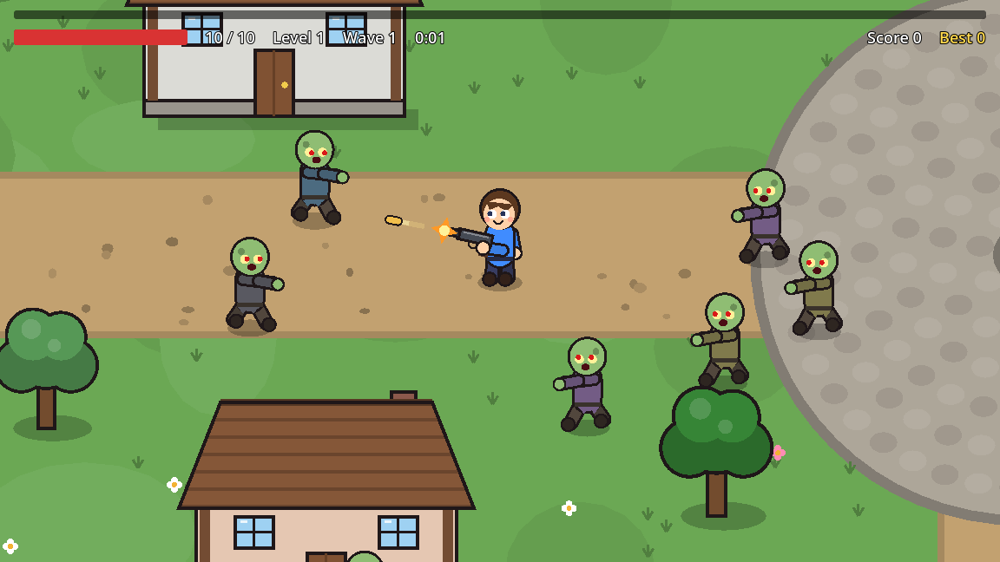
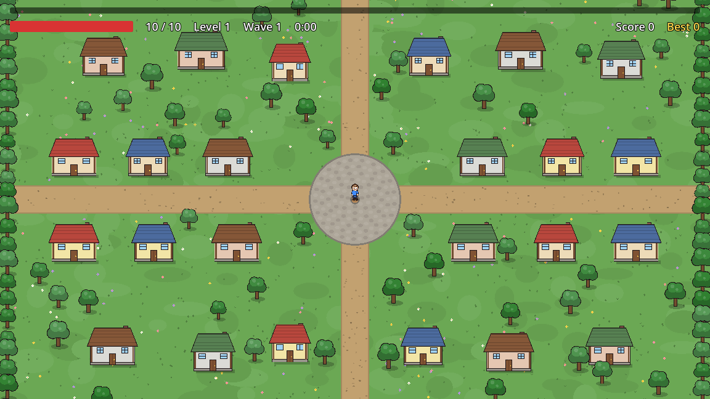
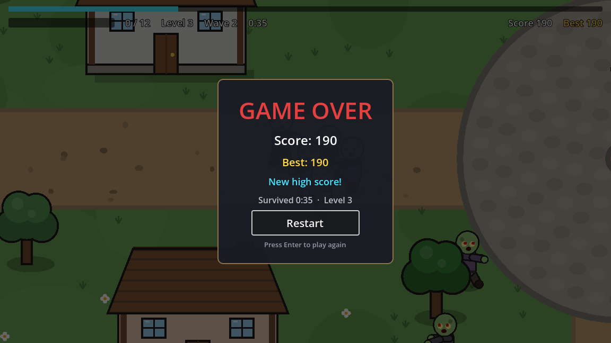

# Survivor Game

A 2D top-down **survivor-style** game built with **Godot 4.7** and **C#**.

A village has been overrun by zombies. Run through its streets while your pistol automatically aims and fires at the nearest zombie. Defeated zombies drop food; eat it to level up and grow stronger. Every 30 seconds a new wave arrives: more zombies, faster and tougher. How long can you survive?



---

## Features

- **Animated cartoon characters drawn entirely in code**: the hero walks, swings their arms, blinks and looks where they're going; zombies stagger with arms stretched out
- **A village to explore**: houses, trees, dirt roads, a cobblestone plaza, flowers and a forest border
- **Depth sorting**: walk behind a house and its roof hides you; walk in front and you're drawn over it
- **Houses and trees block movement and bullets**, so you can use them as cover
- **Smooth 8-direction movement** with a camera that follows the player
- **Zombies that chase you**, walk around obstacles, surround you and push against each other
- **A pistol in the hero's hand** that turns to aim at the nearest zombie and fires on its own, with muzzle flash, recoil and brass bullets
- **Health system**: contact damage, short invulnerability after each hit, hit flashes
- **XP & leveling**: zombies drop food (apples, drumsticks, cheese, carrots) that flies to you; each level makes you fire faster, hit harder and gain max HP
- **Endless waves**: spawn rate, enemy count, health, speed and points scale every 30 seconds
- **HUD**: health bar, XP bar, level, wave, survival time, score and best score
- **Persistent high score**, saved on your computer between sessions
- **Game over screen** with your results and an instant restart

## Controls

| Action | Keys |
|---|---|
| Move | **W A S D** (**Z Q S D** on AZERTY) or **arrow keys** |
| Attack | automatic |
| Restart after game over | **Enter**, **Space** or click **Restart** |

Movement is bound to *physical* key positions, so it works the same on QWERTY and AZERTY keyboards.

## How to play

1. Keep moving: zombies spawn just off-screen and come straight for you, walking around houses and trees on the way.
2. Your pistol aims and fires on its own every 0.6 s at the nearest zombie within range. You just move.
3. Walk near the **food** (apples, drumsticks, cheese, carrots) to eat it and gain XP; it flies to you when you're close.
4. Each **level up** gives +10% fire rate, +1 max HP and heals 3 HP, plus +1 damage on even levels.
5. Each **wave** (every 30 s) makes enemies more numerous, faster, tougher and worth more points.
6. Houses and trees stop bullets, so don't fight from behind them, but use them to break up the crowd.
7. When your health reaches 0, it's game over. Try to beat your best score!





---

## Getting started

### Requirements

- [**Godot 4.7 – .NET edition**](https://godotengine.org/download) (the standard edition can't run C# scripts)
- [**.NET SDK 8.0** or newer](https://dotnet.microsoft.com/download)

### Run the game

1. Clone the repository:

   ```bash
   git clone https://github.com/Nossayba-dev/SurvivorGame.git
   ```

2. Open Godot. In the Project Manager, click **Import** and select the `project.godot` file in the cloned folder.
3. Press **F5** (or the ▶ button) to build and run.

The first launch takes a few seconds while Godot imports assets and compiles the C# project.

---

## Project structure

```text
SurvivorGame/
├── Main.tscn / Main.cs      Game manager: connects every system together
├── Player/                  Player movement, health, XP and leveling
├── Visuals/                 Animated character drawing (shared by player and zombies) + drawing helpers
├── Weapon/                  The pistol: aiming, drawing, auto-fire (timer → nearest zombie → bullet)
├── Projectile/              Bullet that flies straight and damages enemies
├── Enemy/                   Zombie chase AI with obstacle avoidance, health, death, XP drop
├── Pickups/                 Food pickups (XP) with magnet effect, drawn in code
├── Spawner/                 Enemy spawner and wave difficulty scaling
├── World/                   Village: ground drawing, layout, House and TreeProp scenes, outer walls
├── UI/                      HUD and Game Over screen
├── Save/                    High score saving and loading
├── docs/screenshots/        Images used in this README
└── GUIDE.md                 Full learning guide (see below)
```

## Architecture

The game is built from small, independent scenes. `Main` connects them, and the scenes themselves don't depend on each other.

```text
Main (game manager)
├── World                the ground (drawn once) and the outer walls; builds the village
├── Entities             Y-sorted: everything inside is drawn in order of its Y position
│   ├── Props            houses and trees, created by World at startup
│   ├── Enemies          zombies, created at runtime by the spawner
│   └── Player           movement, health, XP
│       ├── Visual       animated character drawing
│       ├── Weapon       the pistol: aims, draws itself, fires projectiles
│       ├── Hurtbox      detects touching zombies
│       └── Camera2D
├── EnemySpawner         creates zombies on free spots, manages waves
├── Hud                  displays values, contains no game logic
└── GameOverScreen       results + restart (keeps running while the game is paused)
```

Communication follows the Godot rule **"call down, signal up"**:

- **Signals** (Godot's version of C# events) report what happened: `Player.HealthChanged`, `Player.XpChanged`, `Player.Died`, `EnemySpawner.EnemyKilled`, `EnemySpawner.WaveChanged`, `GameOverScreen.RestartRequested`.
- `Main` subscribes to them and updates the HUD, the score and the game state.
- **Groups** (`"player"`, `"enemies"`) let nodes find each other without hard-coded paths.
- **Physics layers** separate world, player, enemies, projectiles and pickups, so each object only detects what it should.
- **Y-sorting** gives the top-down view its depth: every character, house and tree has its origin at its feet or base, and Godot draws the ones lower on screen in front.
- **One drawing script, two characters**: `CharacterVisual` draws both the hero and the zombies; only its exported colors and options differ.

## Tech stack

| | |
|---|---|
| Engine | Godot 4.7 (.NET) |
| Language | C# (.NET 8) |
| Physics | Godot 2D physics (`CharacterBody2D`, `Area2D`, `StaticBody2D`) |
| UI | Godot Control nodes (containers, progress bars, labels) |
| Save data | `ConfigFile` in Godot's `user://` folder |
| Art | 100% drawn with code (`_Draw`): characters, houses, trees and ground; no image files |

---

## Learning guide

This project was built step by step as a learning project. [**GUIDE.md**](GUIDE.md) explains everything from zero:

- an introduction to game engines and Godot (nodes, scenes, the game loop, physics, signals)
- the full architecture of the project
- every feature, one by one: what it does, how it works, the key code and the concepts behind it
- a glossary, a table of every tunable value, and ideas to extend the game

## Development history

Each feature was developed and committed separately, so the git history reads like a tutorial:

| Step | Commit |
|---|---|
| 1 | Player with WASD movement |
| 2 | Bounded world with grid and follow camera |
| 3 | Enemy that chases the player |
| 4 | Auto-firing weapon and enemy damage |
| 5 | Player health, contact damage and death |
| 6 | XP gems, leveling and weapon upgrades |
| 7 | Enemy spawner with scaling waves |
| 8 | HUD (health, XP, level, wave, time) |
| 9 | Score and persistent high score |
| 10 | Game over screen with restart |
| 11 | Balance pass |
| 12 | Animated cartoon player character |
| 13 | Zombie enemies |
| 14 | Village world with houses, trees and depth sorting |
| 15 | Visible pistol that aims and fires |
| 16 | Food pickups instead of XP gems |

Use `git log --oneline` to list them and `git show <commit>` to see exactly what each step changed.

## Ideas for the future

- Level-up choices (pick 1 of 3 upgrades)
- More enemy types and weapons
- Pause menu
- Sound effects and music
- Enemy pathfinding with Godot's navigation system
